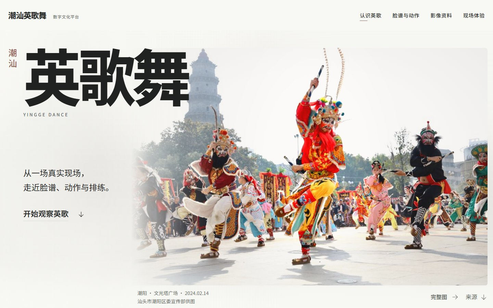
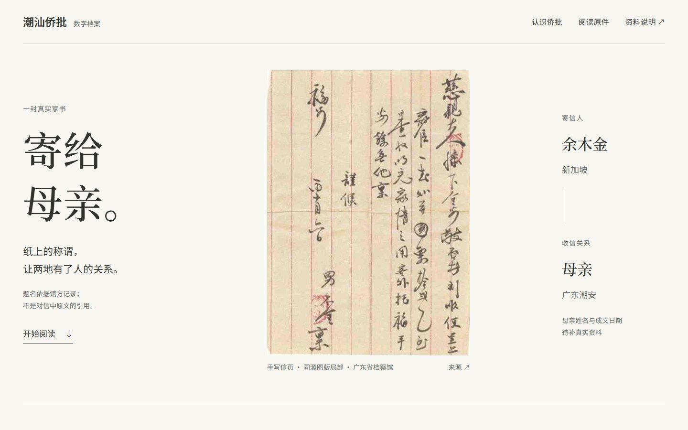
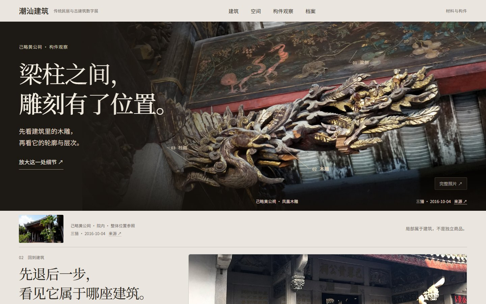

# Culture UI · 潮汕文化 UI 作品集

三个文化题材，三种观看方式。原生 HTML / CSS / JavaScript 视觉与交互原型。

**在线作品集：[hatyorht-HT.github.io/culture-ui-portfolio](https://hatyorht-HT.github.io/culture-ui-portfolio/)**

| 项目 | 观看重点 | 状态 | 实际演示 |
|---|---|---|---|
| 潮汕英歌舞数字文化平台 | 身体、队列、脸谱与传承 | T3冻结视觉基准 | [打开](https://hatyorht-HT.github.io/culture-ui-portfolio/projects/yingge/) |
| 潮汕侨批数字档案 | 手写原件、寄收关系与证据边界 | A/B/C方向研究，未选最终 | [比较方向](https://hatyorht-HT.github.io/culture-ui-portfolio/projects/qiaopi/) |
| 潮汕建筑数字展 | 木雕位置、空间进入与材料观察 | Signature V2冻结视觉基准 | [打开](https://hatyorht-HT.github.io/culture-ui-portfolio/projects/architecture/) |





## 本地预览

安装Python后，在本仓库根目录运行：

```sh
python -m http.server 8000 --bind 127.0.0.1
```

打开 `http://127.0.0.1:8000/`。没有npm、React、后端或数据库依赖。直接打开index.html也可浏览，但建议使用静态服务器。

## 目录

```text
index.html / portfolio.css   作品总览
assets/                     页面预览与展示字体
projects/yingge/            英歌冻结版展示副本
projects/qiaopi/            侨批三方向研究
projects/architecture/      建筑冻结版展示副本
CREDITS.md                  素材与字体来源
```

原项目的视觉与交互保持，侨批不冒称最终成品。未上传参考图库、阶段脚本、用户聊天／决策日志或本机路径。英歌原快照遗漏的一份已链接素材清单在本展示副本中补齐，原冻结文件保留。

## 素材说明

这些是独立设计练习，不代表文化机构官方委托或正式运营服务。照片／馆藏图版保留原出处、摄影署名和适用许可，临时资料不伪称自有资产。详见[CREDITS](CREDITS.md)。项目UI源码不授予第三方影像再使用权；字体许可随资源保留。
