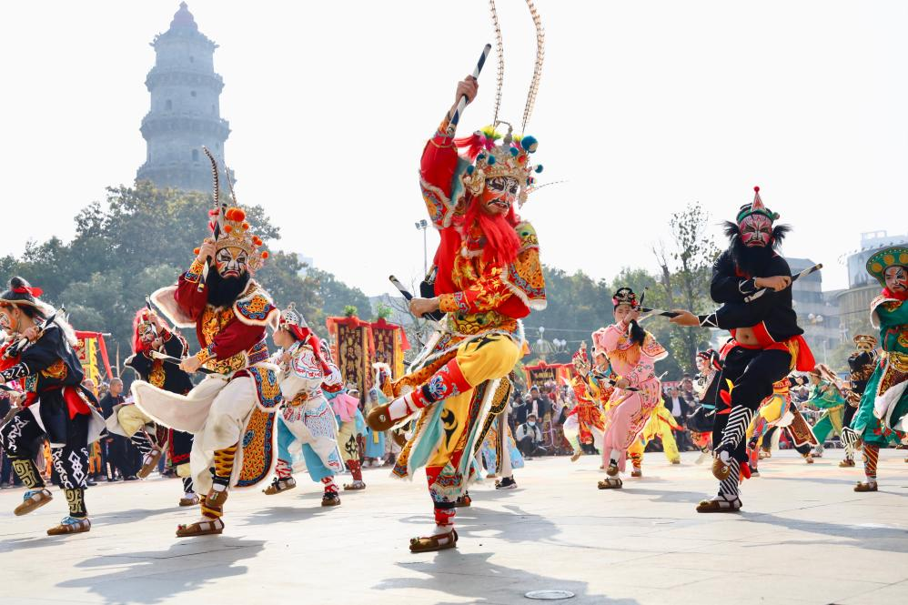
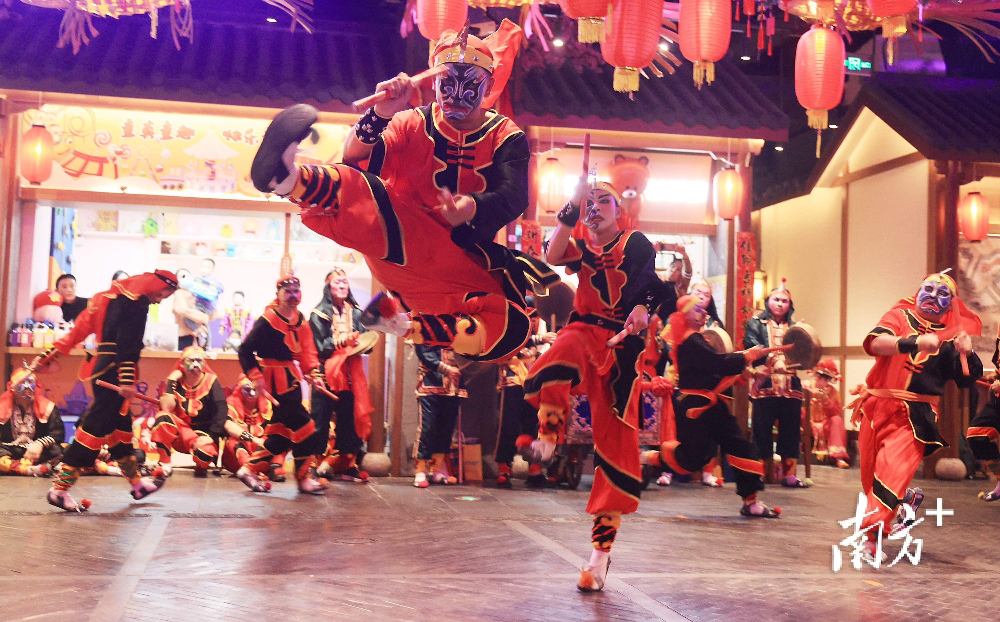
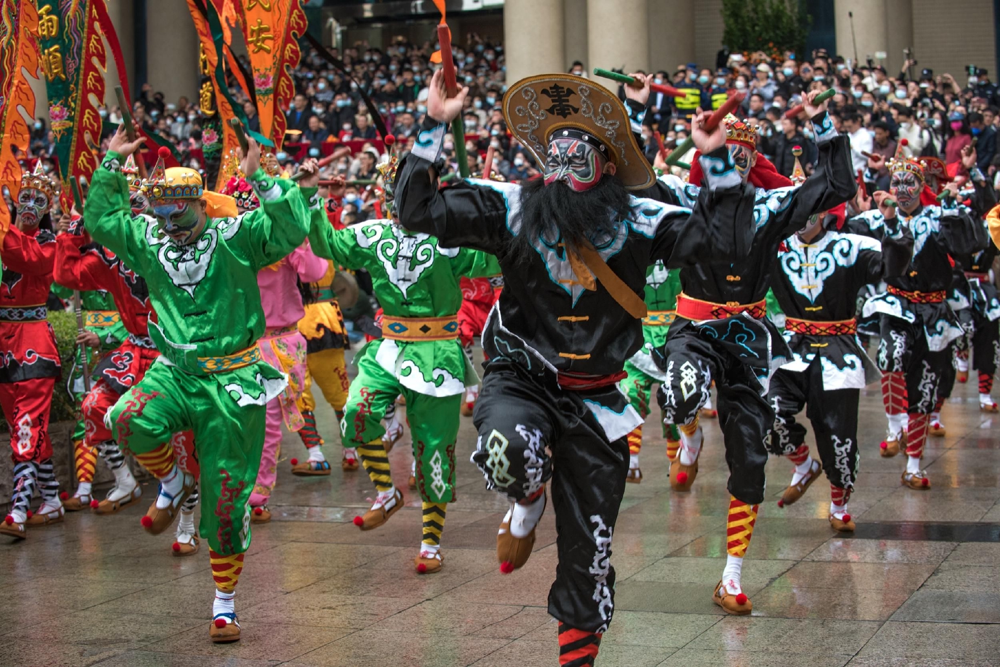
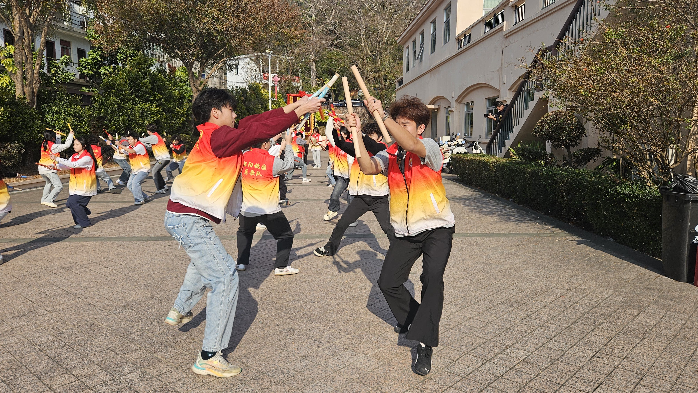
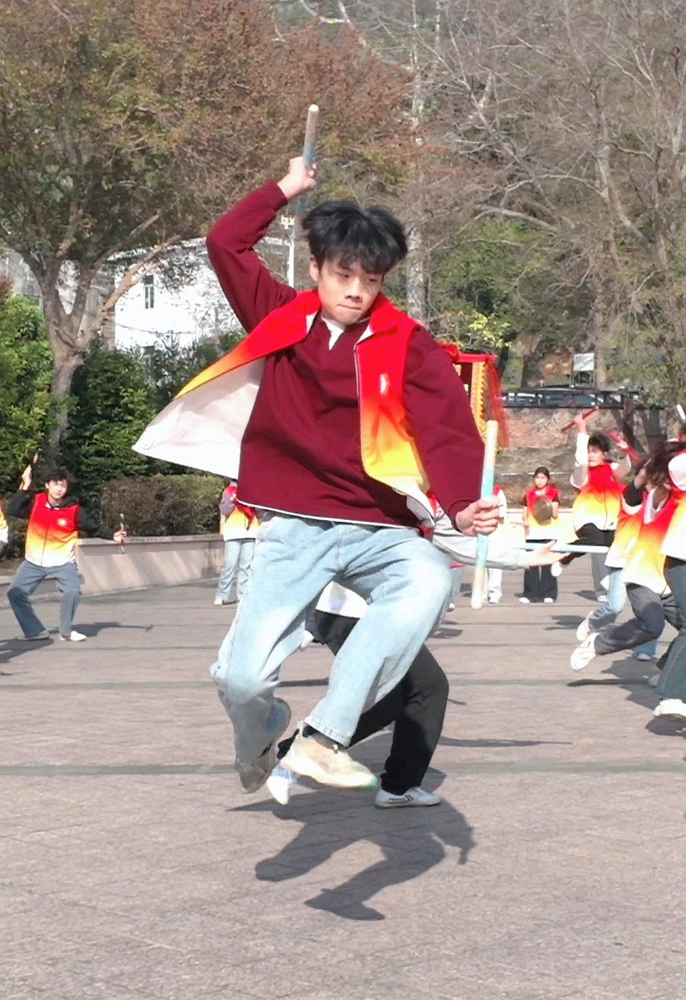
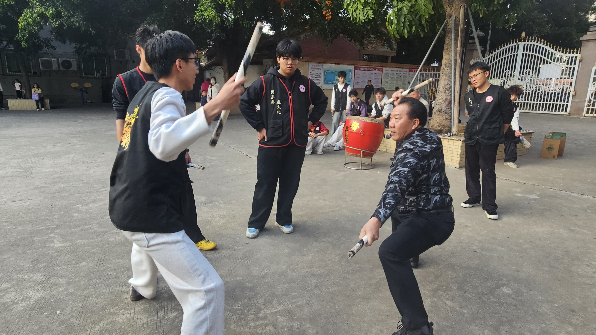

# 用户指定优先素材与资料

记录日期：2026-10-01。此清单优先于上一轮推荐清单；上一轮照片保留为候选，按当前区块任务择用。本轮只补充素材和资料，不修改页面、规则或参考库图片。

已实际下载并查看三张指定图片，以及人民网文章中的三张训练／传艺照片。已读取人民网报道和中国非物质文化遗产网的潮阳英歌项目页。图像保留下载字节，未调色、裁切、去水印、重绘或生成。

## 用途分配

| ID | 本地文件 / 资料 | 优先职责 | 具体观察信息 | 使用边界 |
|---|---|---|---|---|
| P01 | [p01.jpg](user-priority-20261001/p01.jpg)，998 × 665 | Hero / 现场入口 | 前景人物抬腿、举槌与后方队员、观众、广场环境共同说明真实现场 | 仅本张优先考虑Hero。源文件不足宽屏高密度显示需求，不能用放大或AI补细节冒充高清。保留主要人物手、槌、腿和脚；不为宽横比例过度裁掉身体 |
| P02 | [p02.jpg](user-priority-20261001/p02.jpg)，3000 × 1867 | 动作 / 腾跃 | 前景腾跃者的离地脚、屈膝、躯干与持槌方向可见 | 服务动作观察，不再兼作第二个Hero。保留完整动作关系与右下南方+水印。不能由单张照片命名套路或推断完整轨迹 |
| P03 | [p03.jpg](user-priority-20261001/p03.jpg)，2048 × 1367 | 队列 / 群体动作 | 前后排举槌、抬腿及相邻表演者之间的姿态关系 | 是局部队列，可研究同步关系；不能称全阵列图，不能擅自命名阵法。前景人物脚部在源图边界外，不适合完整单人动作图 |
| P04A | [p04a-training.jpg](user-priority-20261001/p04a-training.jpg)，4000 × 2252 | 训练 / 日常习练 | 便服训练、两人配合和背景分组练习，与盛装巡演形成内容差异 | 以来源图注明确的潮阳桃园英歌训练基地为依据；匿名队员不指认姓名。与P04B同场，不在相邻区块重复放大 |
| P04B | [p04b-action-practice.jpg](user-priority-20261001/p04b-action-practice.jpg)，1212 × 1765 | 动作习练备选 | 单人持槌与腿部姿态在竖幅中可辨 | 可作为P04A的备选，或学习专题中的实质补充。不把图中队员自动指认为文章提到的教练；来源未逐图注明个人姓名 |
| P04C | [p04c-teaching.jpg](user-priority-20261001/p04c-teaching.jpg)，4000 × 2252 | 传承 / 传艺关系 | 教者示范、学生持槌与围观关系可见，比孤立人物头像更能说明传艺 | 原文明确右二为翁丁侠。只用于对应人物或该传艺事件，不能替代陈来发等其他人的照片 |
| P05 | [潮阳英歌项目页](https://www.ihchina.cn/project_details/12901.html) | 项目资料 / 历史和流派说明依据 | 核实项目名称、编号、公布批次、申报地区和保护单位 | 是资料页，不是历史现场图，不当作图库；项目叙述不能直接证明某张匿名图的队伍或人物 |

## P01：现场图的确切图注

- 用户提供的[图片直链](https://www.news.cn/local/20250123/37f77efb4b32420ca961987a2a98f5bf/bSKMr3OYSFSxfWc8.jpg)。
- 找到了同一篇[新华网报道《文旅新探丨潮汕英歌舞 槌起春潮涌》](https://www.news.cn/local/20250123/37f77efb4b32420ca961987a2a98f5bf/c.html)，并逐项匹配该图片文件名与相邻图注。
- 图注所述事件：2024-02-14上午，潮阳城区文光塔广场同台表演。
- 供图：汕头市潮阳区委宣传部；这张图的具体摄影者没有单列，不能写成文章其他照片的摄影者邓华。
- 文章发布于2025-01-23 18:12:58，**不作为该照片拍摄日期**。
- 来源说明是多队同台活动；图中具体队伍、演员姓名和角色未由这条图注确认，保留未知。
- 来源照片顶部已截去部分长翎，不能称完整冠饰记录。

## P02：动作图

- [用户提供的南方+图片直链](https://pic.nfapp.southcn.com/nfplus/ossfs/pic/xy/202302/08/955185d31614447dbefd4f0e7f077d00_batchwm.jpg)。
- 图上可辨南方+水印，保留原水印。
- 已确认的是可见的腾跃姿态、服饰与持槌；尚未确认原报道标题、摄影者、具体队伍、演员姓名、角色、地点和拍摄日期。
- URL中的`202302/08`只记录为路径信息，不直接认定为拍摄日期。
- 宣传裁切之外应保留这张完整来源画面；不能去掉脚部、持槌手部来制造“动作特写”。

## P03：群体动作图

- [用户提供的新浪图片直链](https://n.sinaimg.cn/sinakd20230127s/215/w2048h1367/20230127/6e34-16cdc1a89e0069ae3ad68e5acbf8f4ee.jpg)。
- 新浪图片服务器是已确认的取得渠道，不自动等于原摄影作者或版权持有人。
- 原报道与图注尚未匹配；队伍、人物、身份、地点和拍摄日期均待核实。
- 文件路径中的20230127不是独立拍摄日期证据；不能依据旗帜局部或服饰猜队名。
- 手机端优先完整横图加邻接文字，或可查看完整横图；不要只截前景一个人后仍称“队列观察”。

## P04：训练与传承的原文匹配

来源：[人民网广东频道《新春走基层｜广东潮阳：英歌“出圈”》](https://gd.people.com.cn/n2/2026/0211/c123932-41499866.html)。作者涂胜、张永生，发布于2026-02-11 10:46。HTTPS读取遇到证书／网关问题后，通过同域同路径的HTTP页面取得正文，匹配了图片地址、alt与相邻图注；没有关闭TLS验证。

| ID | 原文对应内容 | 摄影署名 | 时间处理 |
|---|---|---|---|
| P04A | 潮阳桃园英歌训练基地的嘉年华备训 | 人民网 张永生 | 正文叙述2月5日训练；照片图注未单列拍摄日期，发布日期另记 |
| P04B | 同基地武打动作练习 | 人民网 涂胜 | 图注未单列拍摄日期，不从URL推定 |
| P04C | 翁丁侠向返乡大学生示范动作 | 人民网 张永生 | 图注未单列拍摄日期，不直接写成报道发布日期 |

原文介绍翁丁侠为潮阳英歌市级代表性传承人、城南忠精英歌队队长；不升级成国家级身份。图片区中的其他人物不自动指认为文中提到的郑浩彬。身份说明始终与原文对应照片一起使用。

## P05：潮阳英歌资料核验

已实际读取[中国非物质文化遗产网《英歌（潮阳英歌）》](https://www.ihchina.cn/project_details/12901.html)。本地留存页面和文本为`user-priority-20261001/p05.html`、`p05.txt`，只作来源核对，不作为对外页面。

- 项目序号：111。
- 项目编号：Ⅲ-8。
- 公布时间：2006（第一批）。
- 类别：传统舞蹈。
- 申报地区或单位：广东省汕头市。
- 保护单位：汕头市潮阳区文化馆。
- 可支持潮阳英歌项目概况以及慢板、中板、快板的资料入口；只记录资料页论述，不据匿名照片自行分派流派。
- 资料页正文的具体编纂／更新时间未标明；其中历史沿革、起源解释和保护现状须保留来源语境，不把旧有“濒临断代”等表述直接移作2026年现状判断。

## 临时使用协议与优先级

1. 本组属于用户明确指定的**优先临时视觉素材**，不是最终正式资产。当前共六张不同照片，不要求六张同时上首页。
2. Hero优先评估P01；动作优先P02；群体动作优先P03；日常训练优先P04A；传艺优先P04C。P04B保留为动作习练备选，P05用于资料说明。
3. 原有近景脸谱图仍可保留观察职责；不能为了“全部使用新素材”再把任何现场图硬塞进脸谱栏目。选择以对象可辨和内容对应为准。
4. 图注保留来源、可核实的署名和事件日期；未确认字段使用“未核实／待核实”，不由URL或视觉猜测补齐。
5. 不去水印，不生成历史照片或人物，不改变源图真实性；任何后续页面裁切须保留完整观看路径并标明局部。
6. 当前未取得正式上线授权，未把公开可访问解释为自由使用。正式发布前逐图重新确认版权持有人、署名要求、裁切许可、网站展示／传播范围与授权凭证。人民网页面明示保留版权和书面授权要求。
7. 全部为当代照片或当代项目资料，不冒充历史原件。当前没有修改现有HTML、CSS、JS、参考图或规则文件。

下载地址和字节哈希见本目录下`user-priority-20261001/retrieval.json`、`people-selected-images.json`。三张传艺／训练图的来源图注匹配见`people-image-captions.json`；新华图片图注匹配见`xinhua-image-captions.json`。
